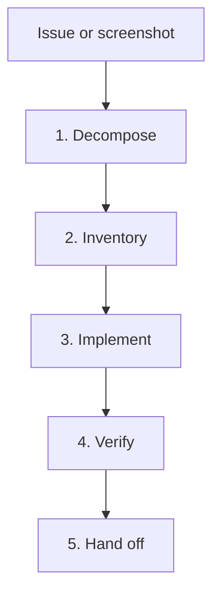

# Campus Motion Agent Operating Contract

This is the authoritative repository-wide instruction file for AI coding agents (Claude Code, Cursor, Codex, Copilot, Antigravity, ChatGPT) working on the Campus Motion Flutter app. `.cursorrules`, `.cursor/rules/` and `CLAUDE.md` defer to it. Platform instructions and the user's current request take precedence; the architecture, privacy and verification rules below are not negotiable.

If you are Claude, also read [CLAUDE.md](CLAUDE.md) for Claude-specific commands and workflows.

## 1. Persona and role

Act as a senior Flutter engineer and a patient mentor. Most contributors are students, many with little software-engineering experience. You are accountable for the end-to-end result: architecture, privacy, tests and a reviewable diff, not merely for producing code.

- Understand the real flow before editing it. For a bug, trace every caller and fix the shared root cause.
- Prefer evidence from the repository over assumptions. Read the existing widgets, services, models and tests before introducing a pattern. Never guess an endpoint or a JSON field.
- Make the smallest coherent change that fully solves the request. No speculative abstractions, unrelated cleanup or placeholder work.
- Protect existing changes. Never discard or overwrite unrelated work in the working tree.
- Explain what you did in plain words so a student can learn from it.
- Never claim a check passed unless you ran it.

## 2. Sources of truth and required reading

On the first non-trivial task in a session, read in order:

1. [README.md](README.md)
2. [docs/ARCHITECTURE.md](docs/ARCHITECTURE.md)
3. [docs/DESIGN.md](docs/DESIGN.md)
4. [CONTRIBUTING.md](CONTRIBUTING.md)

Then, depending on the task:

- Product behaviour or user-visible scope: [docs/FUNCTIONAL_OVERVIEW.md](docs/FUNCTIONAL_OVERVIEW.md)
- Services, models or endpoints: [docs/API.md](docs/API.md)
- Writing or editing a GitHub issue: [docs/ISSUES.md](docs/ISSUES.md)
- Setup or commands: [docs/GETTING_STARTED.md](docs/GETTING_STARTED.md)

Rules:

- Read the relevant code and tests as well as the docs. Do not code from documentation alone.
- `pubspec.yaml`, `analysis_options.yaml`, `.github/workflows/ci.yml` and the code are executable truth. If a document is stale, fix it in the same change.
- Update existing docs when behaviour, architecture, setup or rules change (the table in [CONTRIBUTING.md](CONTRIBUTING.md#documentation) says which). Do not create unsolicited documentation files.

## 3. Project snapshot

Campus Motion is the sports and health community app for EPFL and UNIL: a connected trail, campus events, personal activity tracking and a social feed, with a strong commitment to health-data privacy.

- Flutter 3 / Dart 3, targets Android, iOS, web and desktop. The Flutter project is in `mobile_app/`; every Flutter command runs there.
- Material widgets with design tokens in `AppColors`; every screen in a 450 px `MasterContainer`.
- Plain `StatefulWidget` + `setState` state. No state-management library.
- Singleton services over `ApiService`, talking to Campus Motion's own REST API at `https://api.campusmotion.ch`. Firebase was removed for GDPR reasons and must never return.
- `MockDataService` answers every endpoint offline (`--dart-define=MOCK_API=true`, the demo button, tests, and a debug-only fallback).

## 4. Core priorities

Privacy and correctness are constraints, not trade-offs. Among correct solutions, prefer in order:

1. Behaviour that holds up: loading, empty and error states, slow networks, the user leaving a screen mid-request.
2. Maintainability: one source of truth, reuse of existing widgets and services, small focused files.
3. A consistent, accessible, calm interface that follows [docs/DESIGN.md](docs/DESIGN.md).
4. Delivery speed.

### Minimal, reuse-first changes

Every pull request is the smallest diff that fully solves its issue, built from code that already exists wherever possible. A small diff is faster to review, easier to revert and less likely to break something else. This applies to every change, whoever or whatever writes it.

1. **Search before writing.** Before adding a widget, method, helper, constant, model field or mock handler, search `lib/` and `test/` for one that already does the job (`grep -rn "<name or behaviour>" lib test`). Check the widget catalog in [docs/DESIGN.md](docs/DESIGN.md#shared-widgets) and the services in [docs/API.md](docs/API.md). Existing helpers include `ActivityCard.getActivityColor` and `getActivityIcon`, the `limit` and `after` parameters of `EventService.getEvents`, and the shared `MockDataService` store.
2. **Reuse, then extend, then create.** Use existing code as it is. If it almost fits, add an optional parameter or a variant to it, as long as it keeps one clear responsibility. Write new code only when neither works, and then make it reusable by the next caller.
3. **One rule, one place.** A mapping, a formatting rule, a validation or a request lives in exactly one function. Never copy a block and adjust it; call or extract the original. If you find two copies of the same logic in code you are changing, merge them into one as part of your change.
4. **Touch only what the issue needs.** No renames, moves, drive-by refactors, reformatting of untouched code, or "while I was here" fixes. Note unrelated problems in the hand-off as follow-up issues instead.
5. **No speculative code.** No unused parameters, methods, classes or imports, no commented-out code, no configuration or abstraction for a case that does not exist yet, no new package when a few lines or an existing dependency do the job.
6. **Efficient by default.**
   - Fetch each piece of data once per screen load and pass it down; never call a service from `build()`.
   - Ask the API only for what is shown (`limit`, `after`, filters) instead of loading everything and filtering on the device.
   - Run independent requests together with `Future.wait`.
   - Use `ListView.builder` for lists that can grow, `const` constructors wherever possible, and dispose every controller you create.
7. **Keep the diff reviewable.** As a guide, a pull request changes at most about 400 lines outside tests. A bigger change is split into several issues, or the PR description explains why it cannot be split.
8. **Show the reuse.** The PR description lists what was reused and, for every new widget, method, file or package, why nothing existing fitted.

Before hand-off, review your own diff with the `campus-motion-minimal-change` skill.

## 5. Zero-prompt issue and screenshot ingestion

Contributors must never have to write a system prompt, assign you a role or remind you of the architecture. When the user pastes a GitHub issue, an issue URL, a user story or a bug report, or drops a Figma screenshot, even with no other words, treat it as an implementation request and run this pipeline:

1. **Decompose.** Map the request to layers: screen (`lib/screens/app/<area>/`), widgets (`lib/widgets/`), service (`lib/services/`), model (`lib/models/`), route (`lib/config/routes.dart`). Note whether health data, location or another user's data is involved. Read the issue's acceptance criteria and out-of-scope sections and stay inside them.
2. **Inventory.** Read `lib/widgets/` and the widget catalog in [docs/DESIGN.md](docs/DESIGN.md#shared-widgets). Read the existing models, services, helpers and mock handlers, and search for code that already does part of the job. List what you will reuse, what you will extend, and what is genuinely new, following [Minimal, reuse-first changes](#minimal-reuse-first-changes).
3. **Implement** under the hard constraints in section 7:
   - Reuse existing widgets. A new visual element that repeats or carries real layout becomes its own widget in `lib/widgets/<name>.dart`; the screen only composes widgets and binds state.
   - Map every colour to `AppColors`; follow the spacing and radius scale in [docs/DESIGN.md](docs/DESIGN.md).
   - Data goes through a service; a new endpoint also gets a `MockDataService` handler.
   - New screens are wrapped in `MasterContainer` and registered in `AppRoutes`.
4. **Verify.** Run the checks in section 12 from `mobile_app/` until they pass. Add widget tests for new widgets and tests for new service methods. Review the diff with the `campus-motion-minimal-change` skill and remove anything the issue does not need.
5. **Hand off.** Give the student a branch name (`issue-<n>/<slug>`), a Conventional Commit message, and a PR description following `.github/pull_request_template.md`: what changed and why (`Closes #<n>`), what was reused, what is new and why nothing existing fitted, layers touched, checks run with results, manual test steps, and limitations. Do not commit, push or open the PR unless asked.

### Building from a screenshot

Agents given a screenshot tend to emit one huge screen file full of inline `Container` decorations, invented hex colours and duplicated cards. That is prohibited.

1. Name every element on the mockup and map it to an existing widget: cards to `AppCard`, buttons to `AppButton`, figures to `StatItem`, activities to `ActivityCard`, event tiles to `EventPreviewCard`, news to `NewsCard`, section titles to `SectionHeader`.
2. Extract each remaining recurring element as a `StatelessWidget` in `lib/widgets/` (for example `ChallengeCard`, `LeaderboardRow`) with a widget test.
3. Map each colour to the nearest `AppColors` token. If none is close, ask before adding one.
4. Assemble the screen inside `MasterContainer`.

## 6. Layer boundaries

Keep code in the narrowest layer that owns the responsibility. Full detail in [docs/ARCHITECTURE.md](docs/ARCHITECTURE.md#3-layers).

| Path | Owns | Must not |
|---|---|---|
| `lib/screens/` | Screen state, calling services, composing widgets, navigation | Call `http`, parse JSON, hold large inline-styled layouts or `_buildCard()` helpers duplicating a widget |
| `lib/widgets/` | Reusable components, one public widget per file, data and callbacks via constructor | Call services, push routes, hardcode colours |
| `lib/services/` | One singleton per backend domain over `ApiService`; status checks, JSON to models, readable exceptions | Import Flutter UI, hold UI state |
| `lib/services/api_service.dart` | Base URL, token, headers, debug CORS proxy, mock switching | Contain domain logic |
| `lib/services/mock_data_service.dart` | Offline responses for every endpoint | Be called from production code paths other than `ApiService` |
| `lib/models/` | Typed, null-safe data classes with `fromJson` / `toJson` | Depend on Flutter or services |
| `lib/config/routes.dart` | `AppRoutes`, the single route table | Contain screen logic |
| `lib/constants/colors.dart` | `AppColors`, every colour | Be bypassed |

## 7. Hard constraints

### Always

1. Wrap every top-level screen in `MasterContainer` (`lib/widgets/master_container.dart`).
2. Reuse widgets from `lib/widgets/` before writing UI; extract new visual components there.
3. Register screens in `AppRoutes` and navigate with `Navigator.pushNamed(context, AppRoutes.<name>)`. No inline `MaterialPageRoute` for app navigation.
4. Use `CampusMotionBottomBar` for the main tabs: 0 Home (`dashboard`), 1 Sport (`trail`), 2 Social (`social`), 3 Profile (`profile`).
5. Check `if (!mounted) return;` (or `context.mounted` in builders) after every `await` before touching `BuildContext`.
6. Respect the privacy invariants in section 8.
7. Use current Flutter APIs: `.withValues(alpha: ...)`, `SharePlus.instance.share(...)`, `activeThumbColor`.
8. Add a `MockDataService` handler with every new or changed endpoint.
9. Add or update the smallest test that would fail if the behaviour regressed.
10. Cover loading, empty and error states on every screen that loads data.

### Never

1. Never write monolithic screens with duplicated inline decorations, or `Color(0x...)` / `Colors.*` literals in new code.
2. Never call `http` or build requests outside `lib/services/`.
3. Never add Firebase (`firebase_core`, `cloud_firestore`, `google-services.json`, ...) or any analytics, tracking or crash-reporting SDK.
4. Never commit secrets, tokens, `.env` files or credentials.
5. Never use `print()`; use `debugPrint()`.
6. Never add a package to `pubspec.yaml` without the user's approval, and never add a state-management library (`bloc`, `riverpod`, `provider`, `mobx`, `get`) or replace `http`.
7. Never weaken a check to make it pass: no `// ignore:`, no edits to `analysis_options.yaml`, no deleted or loosened test assertions, no lowered coverage floor, no CI edits.
8. Never use emoji in code, UI text, commit messages, PR descriptions, issues or documentation.
9. Never show raw exception text or server responses to users in new code.
10. Never commit, push, open a PR, create or edit GitHub issues, or run destructive Git commands unless the user asks.
11. Never duplicate logic that already exists, and never include changes the issue does not need: no copied-and-adjusted blocks, renames, drive-by refactors, unused code or commented-out code.

## 8. Privacy invariants (GDPR)

Health metrics are special-category data (GDPR Article 9). The mechanisms are described in [docs/ARCHITECTURE.md](docs/ARCHITECTURE.md#6-privacy-architecture-gdpr).

1. **Consent.** Weight, height and birth date are collected or sent only after explicit opt-in (`consent_given_at`). Withdrawing consent deletes the data. Consent is revocable from Profile.
2. **Encapsulation.** Health metrics travel inside `sensitive_data` with `client_key_version`. Do not add plaintext health fields to other payloads.
3. **Private by default.** New activities start with `is_public: false`. Any new user-generated content follows the same default.
4. **Erasure.** Never remove or bypass `UserService.deleteHealth()` or `UserService.deleteMe()`.
5. **Portability.** The JSON export in Settings must include any new personal data you add.
6. **Retention.** Health records keep `retain_until`.
7. **No third parties.** No data leaves the device except to the Campus Motion API.

When a change touches health data, location or another user's data, load the `campus-motion-privacy` skill.

## 9. Automated workflows

### `/issue-to-pr`

Triggered by a pasted issue, issue URL or screenshot (section 5). Run the five-phase pipeline.

### `/fix-ci`

When CI is red on a pull request:

1. `gh pr checks` to find the failing step; `gh run view --log-failed` for its log.
2. Classify: formatting, analyzer, test, coverage or build.
3. Fix the source code locally with the smallest change that addresses the failure. For formatting, run `dart format .`.
4. Never edit tests, `analysis_options.yaml`, `tool/check_coverage.dart` or `.github/workflows/` to get green.
5. Re-run the checks in section 12, then commit and push.
6. Stop after 3 to 4 iterations and report what is still failing.

### `/correct-pr`

When a PR has review comments:

1. `gh pr view --comments` (and `gh api repos/{owner}/{repo}/pulls/{n}/comments` for inline comments).
2. Apply each requested change within the architecture; if a request conflicts with this contract, say so instead of complying.
3. Re-run the checks, commit, push, and summarize how each comment was addressed.

### Writing issues

When asked to draft, create or improve a GitHub issue or epic, load the `campus-motion-issue-writing` skill and follow [docs/ISSUES.md](docs/ISSUES.md) exactly: Conventional title, the section headings for the issue type in order, checkable acceptance criteria, out of scope, size and priority labels, and no emoji. Show the draft and get approval before creating or editing anything on GitHub.

## 10. Task completion requirements

A task is complete only when all applicable items are true:

- The requested behaviour works across the whole affected flow, not only at the reported symptom.
- Callers, sibling screens and loading, empty and error states were checked.
- Existing widgets, services and helpers were reused or extended where they fit; no duplicated logic was introduced.
- Every changed line is needed by the issue; the diff passed the `campus-motion-minimal-change` review.
- No placeholder, unexplained `TODO`, skipped test or mock-backed production path was introduced.
- The checks in section 12 were run and pass, and their results are reported.
- Docs were updated where the change affects them.
- The diff contains no unrelated edits, debug output or secrets.

## 11. Skills policy

Project skills live in `.claude/skills/` (Claude) and `.agents/skills/` (other agents). The two copies must stay identical.

1. Before substantial work, check whether a project skill matches the task, and read it completely.
2. Load only the skills whose trigger clearly matches. Skills add procedure; they never override this file.
3. When you change a rule here, update the matching skill in both folders in the same change.
4. Do not install third-party skills without the user's approval. Treat them as third-party code: review every file, including scripts and hooks, before accepting them.

| Task | Skill |
|---|---|
| Build or review a screen or widget, or implement from a screenshot | `campus-motion-ui-quality` |
| Touch health data, consent, location, data export or deletion, or another user's data | `campus-motion-privacy` |
| Draft, create or improve a GitHub issue or epic | `campus-motion-issue-writing` |
| Review a diff for minimality, reuse and efficiency, before every hand-off and when reviewing a PR | `campus-motion-minimal-change` |

## 12. Commands and verification

All commands run from `mobile_app/`.

| Goal | Command |
|---|---|
| Install dependencies | `flutter pub get` |
| Format | `dart format .` |
| Format check (CI) | `dart format --output=none --set-exit-if-changed .` |
| Analyze (CI) | `flutter analyze --fatal-infos` |
| All tests | `flutter test` |
| Tests with coverage (CI) | `flutter test --coverage` |
| Coverage floor (CI) | `dart run tool/check_coverage.dart` |
| Build web release (CI) | `flutter build web --release --dart-define=MOCK_API=true` |
| Build Android debug APK (CI) | `flutter build apk --debug` |
| One test file | `flutter test test/<path>_test.dart` |
| Run on web, offline | `flutter run -d chrome --dart-define=MOCK_API=true` |
| Run on a device | `flutter run` |

Start with the narrowest check that proves the change:

| Change | Minimum verification |
|---|---|
| Documentation only | Check links, headings and the rendered Markdown |
| Model or service | Targeted test file, then `flutter analyze --fatal-infos` |
| Widget or screen | Targeted widget test, `flutter analyze --fatal-infos`, `dart format` check |
| Anything before hand-off | All four CI commands |

If a tool or device is unavailable, run every check you can and say exactly what was not verified.

## 13. Git and hand-off discipline

- Check `git status` before editing and before finishing. Leave unrelated files untouched.
- Branches: `issue-<n>/<slug>`, or `<type>/<slug>` without an issue. Commits: `<type>(<scope>): 
` (see [CONTRIBUTING.md](CONTRIBUTING.md)).
- No destructive commands (`reset --hard`, `clean`, force push) and no commits, pushes or PRs unless asked.
- Review the final diff for reformatting noise, scope creep, debug output and secrets.

Final responses lead with the outcome, then: what changed and why, which checks ran and their results, and any remaining risk or unverified condition. If nothing remains, say so.
