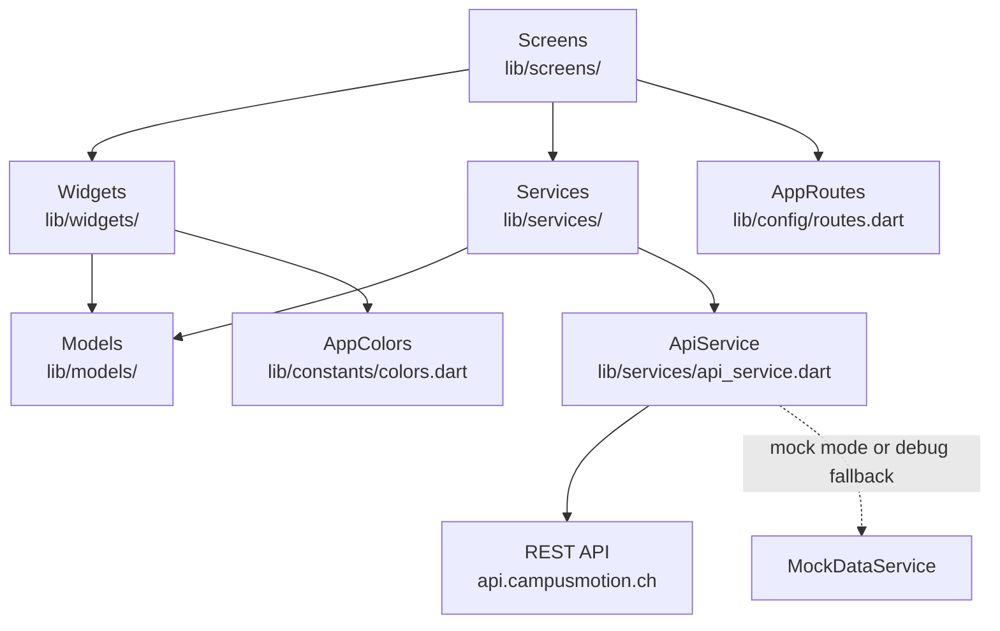
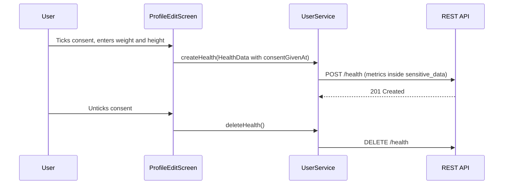

# Technical architecture

This document is the technical source of truth: tech stack, layers, repository layout, routing, services, mock mode, privacy architecture, conventions and testing. For the product picture read [FUNCTIONAL_OVERVIEW.md](FUNCTIONAL_OVERVIEW.md); for the backend contract read [API.md](API.md); for the visual system read [DESIGN.md](DESIGN.md).

## 1. Tech stack

| Concern | Choice | Notes |
|---|---|---|
| Framework | **Flutter 3**, **Dart 3** (sound null safety) | One codebase for Android, iOS, web and desktop. |
| UI | Material widgets, custom tokens in `AppColors` | Theme seeded from the brand colour in `main.dart`. |
| Navigation | `Navigator` with named routes | One route table: `AppRoutes` in `lib/config/routes.dart`. |
| State | `StatefulWidget` + `setState`, `FutureBuilder` | No state-management library. Do not add one for a single feature. |
| Networking | `http` package behind `ApiService` | Bearer JWT, JSON in and out. |
| Backend | Campus Motion REST API, `https://api.campusmotion.ch` | Self-hosted and GDPR-compliant. **No Firebase.** |
| Other packages | `intl` (dates), `share_plus` (data export), `flutter_signin_button` | Add a package only with team agreement. |
| Quality | `flutter_lints`, `dart format`, `flutter test`, coverage floor | Enforced in CI. |

## 2. History and key decisions

These decisions explain constraints that look arbitrary without context. Do not reverse them without a team decision.

- **Flutter instead of React Native (v2).** The project started in late 2025 as an Expo / React Native app. Upstream breakage on SDK updates, styling drift between Android and iOS, and a desire for compile-time type safety led to a rebuild in Flutter in early 2026.
- **Own backend instead of Firebase.** The v1 app stored activity and health data in Firebase. That made GDPR compliance hard and locked student health data into a third-party cloud. Firebase was removed entirely and replaced by a dedicated REST API. Never reintroduce a Firebase package, config file or SDK.
- **A phone-width shell on every platform.** The app is designed for phones. On wide screens it renders in a centred 450 px column (`MasterContainer`) instead of stretching.
- **Mock backend in the app.** Contributors often have no backend access. `MockDataService` lets every screen run offline, and lets tests exercise services without a network.

## 3. Layers

Dependencies point one way. A layer may use the layers below it, never the ones above.



| Layer | Path | Owns | Must not |
|---|---|---|---|
| Screens | `lib/screens/` | Loading data through services, holding screen state, composing widgets, navigation. | Call `http`, build JSON, contain large inline-styled layouts or private `_buildCard()` helpers that duplicate a widget. |
| Widgets | `lib/widgets/` | Reusable visual components, one public widget per file. Take data and callbacks as constructor parameters. | Call services or `Navigator.pushNamed` directly (navigation goes through a callback), hardcode colours. |
| Services | `lib/services/` | One singleton per backend domain. Call `ApiService`, check status codes, parse JSON into models, throw clear exceptions. | Import Flutter UI (`material.dart`), hold UI state. |
| Gateway | `lib/services/api_service.dart` | Base URL, auth token, headers, the CORS proxy for debug web, mock switching. | Contain domain logic. |
| Models | `lib/models/` | Typed, null-safe data classes with `factory fromJson` and `toJson`. | Depend on Flutter or on services. |
| Routes | `lib/config/routes.dart` | Route name constants and the `generateRoute` switch. | Contain screen logic. |
| Tokens | `lib/constants/colors.dart` | Every colour the app uses. | Be bypassed by inline `Color(0x...)` or `Colors.*` in screens and widgets. |

## 4. Repository layout

```
mobile-app-v2/                      repository root: docs and agent instructions
  AGENTS.md  CLAUDE.md  CONTRIBUTING.md  README.md
  docs/                             documentation (this folder)
  .github/workflows/ci.yml          CI: format, analyze, test, coverage
  .github/ISSUE_TEMPLATE/           issue forms
  .claude/skills/  .agents/skills/  project skills for AI agents (mirrored)
  .cursor/rules/  .cursorrules      Cursor rules (pointers to AGENTS.md)
  mobile_app/                       the Flutter project; run commands here
    pubspec.yaml  analysis_options.yaml
    lib/
      main.dart                     entry point, theme, initial route
      config/routes.dart            AppRoutes
      constants/colors.dart         AppColors
      models/                       activity, event, health, news_item, user, user_preferences
      services/                     api, auth, user, activity, event, news, mock_data
      widgets/                      shared components (catalog in DESIGN.md)
      screens/
        auth/                       welcome, sign_in, sign_up
        app/
          home/                     Home tab
          activity/                 Sport tab (activities, events, trail)
          social/                   Social tab
          profile/                  Profile tab, edit, settings
          feed/  base_menu/         placeholders, not routed yet
    test/                           unit and widget tests
      widgets/                      one test file per shared widget
    tool/check_coverage.dart        coverage floor used by CI
    assets/                         images and fonts
```

A screen folder uses `index.dart` for the tab's root screen and a descriptive name for each sub-screen (`profile/edit.dart`, `profile/settings.dart`).

## 5. Key runtime flows

### Startup and sign-in

`main()` starts on `AppRoutes.login` (the welcome screen). Sign-in calls `AuthService.login`, which posts to `/auth/login`, stores the JWT in `ApiService`, and loads the current user. Sign-up calls `/auth/register`. The token lives in memory only, so a restart signs the user out.

### Routing

Every screen is registered in `AppRoutes`:

| Constant | Path | Screen |
|---|---|---|
| `login` | `/` | `WelcomeScreen` |
| `signup` | `/signup` | `SignUpScreen` |
| `signin` | `/signin` | `SignInScreen` |
| `dashboard` | `/dashboard` | `HomeIndexScreen` (Home tab) |
| `trail` | `/trail` | `ActivityIndexScreen` (Sport tab) |
| `social` | `/social` | `SocialIndexScreen` (Social tab) |
| `profile` | `/profile` | `ProfileIndexScreen` (Profile tab) |
| `editProfile` | `/profile/edit` | `ProfileEditScreen` |
| `parameters` | `profile/parameters` | `ProfileSettingsScreen` |
| `shareProfile` | `profile/share` | placeholder, routes to Home |

To add a screen: add a constant, add a `case` in `generateRoute`, navigate with `Navigator.pushNamed(context, AppRoutes.<name>)`. Pass arguments through `RouteSettings.arguments`, not by constructing `MaterialPageRoute` inline in a screen. This table must be updated in the same PR.

### Bottom navigation

The four tabs (0 Home, 1 Sport, 2 Social, 3 Profile) are rendered by `CampusMotionBottomBar` (`lib/widgets/bottom_bar.dart`), passed to `MasterContainer.bottomNavigationBar` by each tab screen. Switching tabs should replace the current route rather than push onto the stack; centralizing this in the bottom bar is tracked in issue #5.

### Data loading

A screen holds a service instance, starts the request in `initState`, and renders the result with `FutureBuilder` or by calling `setState` when the future completes. After any `await`, it checks `if (!mounted) return;` before touching `context`. Pull-to-refresh goes through `MasterContainer.onRefresh`.

### Mock mode

`ApiService.mockMode` routes every request to `MockDataService`, an in-memory store with realistic data for every endpoint in [API.md](API.md). It is enabled by:

- `--dart-define=MOCK_API=true` at launch;
- `AuthService.enterDemoMode()`, behind the demo button on the welcome and sign-in screens;
- tests, which set `ApiService.mockMode = true` in `setUp`.

In debug builds only, `ApiService` also falls back to mock data when a request throws or the server returns a 5xx status. Release builds rethrow.

**Rule:** when you add or change an endpoint in a service, add the matching handler to `MockDataService` in the same PR, so the feature works offline and can be tested.

## 6. Privacy architecture (GDPR)

Health metrics are special-category data under GDPR Article 9. These mechanisms implement the promises in [FUNCTIONAL_OVERVIEW.md](FUNCTIONAL_OVERVIEW.md#5-the-privacy-promise):

| Promise | Mechanism |
|---|---|
| Explicit consent (Art. 9) | `ProfileEditScreen` shows a consent checkbox. Health data is only sent with `consent_given_at` set; unchecking deletes it (`UserService.deleteHealth`). |
| Encapsulation | `HealthData.toJson` wraps `weight_kg` and `height_cm` in a `sensitive_data` JSON string with `client_key_version`. |
| Private by default | The log-activity form starts with `isPublic = false`. |
| Erasure (Art. 17) | Settings: delete health data (`DELETE /health`) and delete account (`DELETE /users/me`). |
| Portability (Art. 20) | Settings: export profile, preferences, health and activities as JSON through `share_plus` (`_exportData`). |
| Storage limitation (Art. 5) | Health records carry `retain_until`. |
| No third parties | The only network host is the Campus Motion API (plus the CORS proxy in debug web builds). No analytics or crash SDKs. |



Any change that collects, displays or shares health data, location, or another user's data must keep every row of this table true.

## 7. Coding conventions

- **Files:** `snake_case.dart`, one public widget or class per file. Shared widgets in `lib/widgets/<name>.dart`.
- **Imports:** package imports (`package:mobile_app/...`).
- **Widgets:** prefer `StatelessWidget` with `const` constructors; use `StatefulWidget` only for local state. Use `super.key`.
- **Size:** keep screens focused. When a screen passes roughly 300 lines, extract widgets. (The 1,000-line Sport screen is being split in issue #9.)
- **Colours:** only `AppColors`. Spacing and radii follow [DESIGN.md](DESIGN.md).
- **Async:** `if (!mounted) return;` (or `if (!context.mounted) return;` in a builder) after every `await` before using `context`.
- **Errors:** services throw `Exception` with a readable message; screens catch and show a `SnackBar` or an error state. Never swallow an exception silently.
- **Logging:** `debugPrint`, never `print`.
- **Modern APIs:** `.withValues(alpha: ...)` instead of `.withOpacity()`, `SharePlus.instance.share()` instead of `Share.share()`, `activeThumbColor` instead of `activeColor` on switches.
- **Lints:** never add `// ignore:` or relax `analysis_options.yaml` to get green. Fix the code.

## 8. Testing and quality gates

| Kind | Where | What it covers |
|---|---|---|
| Widget tests | `test/widgets/<widget>_test.dart` | Each shared widget renders, reacts to taps, handles missing data. Pump inside `MaterialApp`. |
| Service tests | `test/` | Services against `MockDataService` (`ApiService.mockMode = true`), model parsing. |
| Model tests | `test/` | `fromJson` / `toJson` round trips, including old payloads without new fields. |

CI (`.github/workflows/ci.yml`) runs on every push to `main` and every pull request:

1. `dart format --output=none --set-exit-if-changed .`
2. `flutter analyze --fatal-infos`
3. `flutter test --coverage`
4. `dart run tool/check_coverage.dart` (line coverage floor, 15% today; raise it, never lower it)

A test file must end in `_test.dart` or `flutter test` will not run it.
