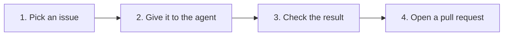

# Student workflow guide

Welcome to the Campus Motion team. This guide is for contributors who are new to software engineering, Flutter or Git, and who want to work with an AI coding agent (Claude Code, Cursor, Codex, Copilot, Antigravity). If you already know the workflow, [../CONTRIBUTING.md](../CONTRIBUTING.md) is the short version.

## What the agent already knows

The repository contains an operating contract for AI agents, [AGENTS.md](../AGENTS.md), plus project skills in `.claude/skills/` and `.agents/skills/`. Agents that work inside the repository read them automatically. They already know the architecture, the privacy rules, the widget library and the checks to run.

So you do not need to write a long prompt or explain the project. You give the agent the issue, and it follows the contract. Your job is to check its work.

## The four steps



### 1. Pick an issue

1. Open the [issue list](https://github.com/Campus-Motion/mobile-app-v2/issues). If this is your first contribution, filter by `good first issue`.
2. Assign yourself, or comment that you are taking it.
3. Read the whole issue, especially **Acceptance criteria** and **Out of scope**. If something is unclear, ask in a comment before starting.
4. Create a branch from an up-to-date `main`:

   ```bash
   git switch main
   git pull
   git switch -c issue-4/pull-to-refresh-past-events
   ```

### 2. Give the issue to the agent

Open the **repository root** (not `mobile_app/`) in your editor or terminal, so the agent finds `AGENTS.md`. Then paste the issue title and body, or the issue URL. You can attach a Figma screenshot. That is all; no extra instructions are needed.

The agent will:

1. Map the issue to the layers it touches (screen, widget, service, model, route).
2. Look for existing widgets in `lib/widgets/` and reuse them.
3. Put any new visual component in its own file in `lib/widgets/`, not inline in the screen.
4. Use `AppColors` for every colour and wrap screens in `MasterContainer`.
5. Write or update tests.
6. Run the formatter, the analyzer and the tests.
7. Give you a commit message and a pull request description.

If you only have a browser chat without access to the repository, use [AGENT_PROMPT_TEMPLATE.md](AGENT_PROMPT_TEMPLATE.md) instead.

### 3. Check the result

Never push code you have not looked at. Check three things:

**The checks ran and passed.** The agent should report the result of each command. If it did not, run them yourself from `mobile_app/`:

```bash
dart format .
flutter analyze --fatal-infos
flutter test
```

If something fails, paste the output back to the agent and ask it to fix the code (not the test).

**The app does what the issue asks.** Run it and try the feature yourself. Mock mode means you do not need the backend:

```bash
flutter run -d chrome --dart-define=MOCK_API=true
```

**None of these red flags appear in the diff:**

| Red flag | Why it is wrong | What it should be |
|---|---|---|
| A screen file grows by hundreds of lines of styled `Container`s | Duplicated, untestable UI | New components in `lib/widgets/`, composed by the screen |
| `Color(0xFF...)` or `Colors.red` in a screen or widget | Breaks the design system | A token from `AppColors` |
| A Firebase package or config file | Firebase was removed for privacy reasons | The Campus Motion REST API through a service |
| `http.get` or `http.post` in a screen | Breaks layering, cannot be tested | A method in a service in `lib/services/` |
| A screen without `MasterContainer` | Stretches on web and tablets | Wrap the screen in `MasterContainer` |
| An `await` followed by `context` with no `mounted` check | Crashes when the user leaves the screen | `if (!mounted) return;` after the `await` |
| Weight, height or birth date saved without a consent check | Violates GDPR Article 9 | Check consent first |
| An edited or deleted test, or a new `// ignore:` | Hides a real problem | Fix the code |
| Files changed that the issue does not mention | Scope creep, harder review | Revert them or open a separate issue |

### 4. Open a pull request

```bash
git add <the files you changed>
git commit -m "fix(home): keep the upcoming-events filter on pull-to-refresh"
git push -u origin issue-4/pull-to-refresh-past-events
```

On GitHub, click **Compare & pull request**. Paste the description the agent wrote and check it says:

- what changed and why, with `Closes #4` so the issue closes on merge;
- which layers were touched;
- how it was tested, including manual steps;
- screenshots for any visual change.

CI runs the same checks automatically. A reviewer will then read your code.

## After you open the PR

| Situation | What to tell the agent |
|---|---|
| CI is red | `/fix-ci`. The agent reads the failed logs and fixes the source code. It never weakens a test or a lint rule. |
| A reviewer left comments | `/correct-pr`. The agent reads the comments, applies the changes, re-runs the checks and pushes. |

If you are stuck, ask in the issue or reach out to the project leads.
